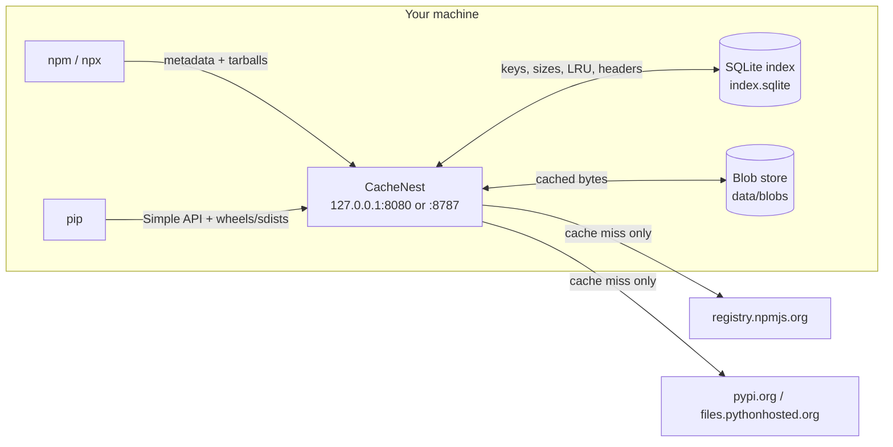
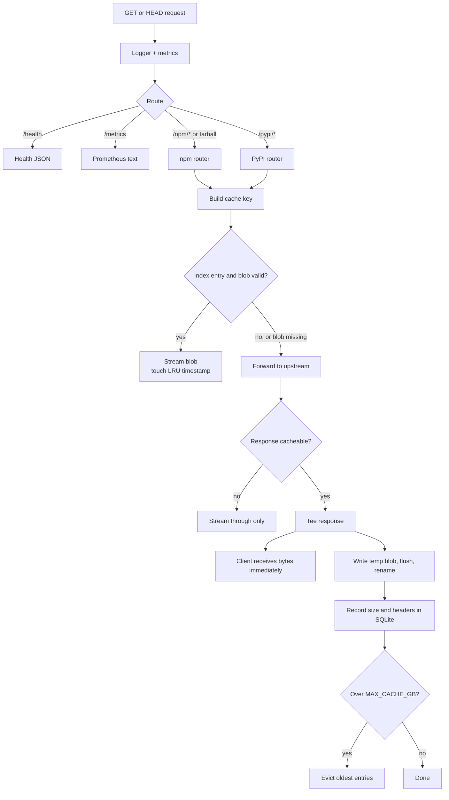
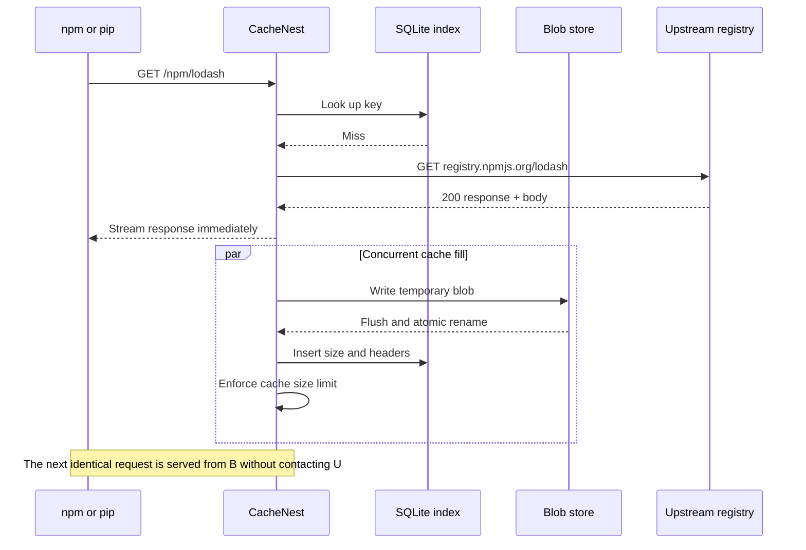

# How CacheNest Works

A visual guide to what CacheNest solves, how a request moves through it, and how cached data is stored on disk.

CacheNest is a **local-first caching reverse proxy for npm and PyPI**. It runs on the same machine you develop on, listens on loopback, and keeps package metadata and artifacts in one durable directory.

---

## 1. What CacheNest solves

Package managers already cache some data, but those caches are usually scoped to one tool, one user, or one project, and they are frequently cleared or bypassed. The same dependencies are then downloaded again and again.

Typical repeated work:

- Installing the same package in several projects.
- Rebuilding `node_modules` or a Python virtual environment.
- Running `npm cache clean`, `pip --no-cache-dir`, or a fresh container.
- Repeating an install after switching branches or testing a clean setup.

Every repeat can mean another round trip to a distant registry, even when the bytes have not changed.

### Without a shared local cache

```text
Project A ─┐
Project B ─┼──> internet ──> registry.npmjs.org / pypi.org
Project C ─┘
```

### With CacheNest

```text
Project A ─┐
Project B ─┼──> CacheNest ──> local disk (cache hit)
Project C ─┘         │
                     └──> internet (first request only)
```

CacheNest gives you:

- **One cache for npm and pip** instead of separate per-tool caches.
- **Fewer upstream requests** for metadata and package files.
- **Fast repeat installs** from local disk.
- **Resilience** for already-cached packages when the upstream registry is slow or unavailable.
- **A simple operational model**: one Node.js process, one SQLite index, one blob directory, no accounts.

It is deliberately **not** a general-purpose HTTP proxy, an `apt` proxy, or a multi-user service.

---

## 2. High-level architecture



| Component | Responsibility |
|---|---|
| HTTP server | Accepts requests, adds request IDs, counts metrics, dispatches routes, handles graceful shutdown. |
| npm router | Maps `/npm/*` to the npm registry and accepts root-level tarball paths that npm generates. |
| PyPI router | Maps `/pypi/*` to the Simple API and file host, and rewrites download links back through CacheNest. |
| `Cache` | Orchestrates hits, misses, response streaming, blob writes, indexing, and eviction. |
| `UpstreamForwarder` | Makes the real upstream request with redirects, timeouts, and header hygiene. |
| `IndexDB` | SQLite index of cache keys, sizes, timestamps, and stored response headers. |
| `BlobStore` | Sharded, atomic storage for response bodies. |
| `Eviction` | Least-recently-used cleanup when the cache exceeds its size limit. |
| Metrics middleware | Counts requests, hits, misses, and bandwidth, and exposes Prometheus text. |

---

## 3. Request lifecycle

### 3.1 Routing

1. The request logger assigns an `x-request-id` and records the method, path, status, duration, and request ID. Query strings are intentionally never logged.
2. The metrics middleware counts every request except `/metrics` scrapes.
3. The server dispatches:
   - `/health` → JSON health and indexed cache size.
   - `/metrics` → Prometheus text.
   - `/npm/*` or a root-level tarball path → npm router.
   - `/pypi/*` → PyPI router.
   - Anything else → `404`.
4. Routers accept only `GET` and `HEAD`; other methods receive `405`.

### 3.2 Cache key

The key is a SHA-256 digest of the uppercase method and the **local request path including the query string**:

```text
cache key = SHA-256("GET /npm/lodash")
```

The key is deliberately based on the URL CacheNest received, not the upstream URL, so a request keeps the same identity regardless of which upstream host is configured.

For npm tarballs requested without the `/npm` prefix, the key is normalized back to the `/npm/...` form. That makes these two requests share one cache entry:

```text
/npm/lodash/-/lodash-4.17.21.tgz
/lodash/-/lodash-4.17.21.tgz
```

### 3.3 Decision flow



### 3.4 Cache hit

1. Look up the key in SQLite.
2. Open the blob from disk.
3. Verify that the blob size matches the index entry. A missing or mismatched blob is invalidated and treated as a miss.
4. Update `last_used` (LRU order).
5. Send the stored headers and stream the blob to the client.

### 3.5 Cache miss



The client does not wait for the cache write. The upstream body is teed: one branch goes to the client, the other is written to disk.

If the client disconnects, the request signal aborts the upstream request and the cache write. Temporary files are removed.

### 3.6 When a response is not cached

A response is stored only when all of these are true:

| Rule | Reason |
|---|---|
| Method is `GET` | `HEAD` and unsafe methods are not stored. |
| Status is `200` | Errors and redirects are passed through. |
| A body exists | Empty responses are not useful cache entries. |
| No upstream `Authorization` header | Authenticated upstream responses are treated as private. |
| `Cache-Control` does not contain `no-store`, `no-cache`, or `private` | Conservative caching. |
| `Vary` is not `*` | `Vary: *` means the response is not reusable. |

If a response is not cacheable, it is streamed to the client and nothing is written to disk.

---

## 4. npm and PyPI specifics

### npm

- `/npm/*` is forwarded to `UPSTREAM_NPM` (default `https://registry.npmjs.org`).
- npm rewrites the host in `dist.tarball` URLs but can drop a registry path prefix such as `/npm`.
- CacheNest therefore also accepts root-level tarball paths matching:

  ```text
  /<package>/-/<file>.tgz
  /@<scope>/<package>/-/<file>.tgz
  ```

- Those fallback requests are cached under the same normalized `/npm/...` key as the prefixed form.

### PyPI

- `/pypi/simple/*` and `/pypi/*` are forwarded to `UPSTREAM_PYPI` (default `https://pypi.org/simple`).
- `/pypi/files/*`, `/pypi/packages/*`, and `/pypi/files.pythonhosted.org/*` are forwarded to the file host (default `https://files.pythonhosted.org`).
- PyPI Simple API JSON and HTML responses are rewritten so file links point back through CacheNest:

  ```text
  https://files.pythonhosted.org/packages/...  →  /pypi/files/packages/...
  ```

  This keeps wheel and source-distribution downloads inside the cache instead of letting pip bypass it.

- Rewriting happens **before** the response body is written to the cache, so the cached copy already contains local links.
- Responses larger than 16 MiB, already compressed, or not JSON/HTML are streamed through without rewriting.

### Upstream forwarding

- Redirects are followed up to 5 times.
- Header timeout is 30 seconds; body timeout is 300 seconds.
- Hop-by-hop headers, `host`, and `content-length` are stripped before forwarding.
- Requests force `accept-encoding: identity` so one compressed variant cannot be cached under the same key as an uncompressed one.
- Connection failures become `502`; timeouts become `504`. Both are JSON responses with `cache-control: no-store` and are never cached.

---

## 5. Storage model

```text
data/
├── index.sqlite          SQLite index (WAL mode)
├── index.sqlite-wal
├── index.sqlite-shm
└── blobs/
    ├── 0a/
    │   └── <64-character SHA-256 key>
    ├── 7f/
    │   └── <64-character SHA-256 key>
    └── ...
```

Blobs are sharded by the first two hex characters of the key to keep directory sizes manageable.

### SQLite index

The `cache_entries` table is the source of truth for cache accounting:

| Column | Meaning |
|---|---|
| `key` | SHA-256 cache key. |
| `size` | Blob size in bytes. |
| `created_at` | Insertion time in milliseconds. |
| `last_used` | Last hit time in milliseconds, used for LRU. |
| `headers` | JSON object of stored response headers. |

SQLite runs in WAL mode with a 5-second busy timeout. The index is the authority for what exists and how large the cache is.

### Atomic blob writes

A cache fill never exposes a partial file:

1. Write to a hidden temporary file in the destination shard:

   ```text
   data/blobs/0a/.<key>.<uuid>.tmp
   ```

2. Flush the completed file to disk.
3. Atomically rename it to its final key path.
4. Insert the size and headers into SQLite.
5. If indexing fails, delete the newly written blob instead of leaving an unindexed file.

A crash can leave an orphaned `.tmp` file, but orphaned files are never served because reads and eviction use the SQLite index and final blob paths only.

### Eviction

After a successful cache insertion, CacheNest checks the total indexed size:

```text
while total > MAX_CACHE_GB:
    delete the least recently used blob
    remove its index row
```

- Eviction runs in batches and is guarded so concurrent calls share one in-flight run.
- A blob that cannot be deleted is remembered for the current run, so it is not selected forever.
- `last_used` is updated on every hit, so frequently used packages stay in the cache longer.

---

## 6. Observability

### Health

`GET /health` returns the indexed cache size:

```json
{"status":"ok","uptimeSeconds":42,"cacheBytes":58583168}
```

### Metrics

`GET /metrics` exposes Prometheus text:

| Metric | Meaning |
|---|---|
| `cachenest_requests_total` | Requests handled, excluding `/metrics` scrapes. |
| `cachenest_cache_hits_total` | Cache lookups served from local disk. |
| `cachenest_cache_misses_total` | Cache lookups that required an upstream fetch. |
| `cachenest_bandwidth_served_bytes_total` | Response bytes sent to clients. |
| `cachenest_bandwidth_saved_bytes_total` | Bytes served from cache instead of upstream. |
| `cachenest_uptime_seconds` | Process uptime. |

### Logs

Each request logs:

```text
GET /npm/lodash 200 12.4ms <request-id> complete
```

Query strings are omitted so tokens or signed URLs cannot leak into logs.

### Shutdown

On `SIGINT` or `SIGTERM`, the server:

1. Stops accepting new connections.
2. Drains in-flight responses for up to 8 seconds.
3. Closes upstream connection pools.
4. Closes the SQLite index.

---

## 7. Design boundaries and known limitations

CacheNest is intentionally small. These are current behaviors, not hidden surprises:

- **No TTL or revalidation.** Cached entries live until LRU eviction or a manual cache reset. npm packuments and PyPI index pages can become stale after a new release.
- **The cache key ignores request headers.** `Vary: Accept` is not used to separate representations. Use CacheNest from npm and pip, not by manually browsing the proxy URLs, because a browser request can occupy the same key with a different `Accept` header.
- **No request coalescing.** Two simultaneous misses for the same key can both contact upstream.
- **`HEAD` is not stored.** A `HEAD` request is proxied but does not warm the cache.
- **`Range` is not handled on hits.** A cache hit returns the full cached body rather than a partial response.
- **No authentication.** The design assumes loopback-only access. Keep `HOST=127.0.0.1` for direct runs and `CACHENEST_BIND=127.0.0.1` for Docker.
- **No purge command.** To reset the cache, stop CacheNest and remove the data directory:

  ```bash
  docker compose down
  rm -rf data
  docker compose up -d
  ```

These boundaries keep the implementation fast and easy to reason about. See [QUICKSTART.md](QUICKSTART.md) for the practical reset and usage workflow.

---

## 8. Where the code lives

| Concept | File |
|---|---|
| Configuration and environment variables | `src/config.js` |
| Process startup, startup banner, signal handling | `src/index.js` |
| HTTP server, middleware chain, routing, shutdown | `src/server.js` |
| Cache hit/miss orchestration and cacheability rules | `src/core/cache.js` |
| SQLite index and LRU metadata | `src/core/index-db.js` |
| Atomic sharded blob storage | `src/core/store.js` |
| Size enforcement and eviction | `src/core/eviction.js` |
| npm routing and tarball fallback | `src/routes/npm.js` |
| PyPI routing and link rewriting | `src/routes/pypi.js` |
| Shared HTTP route helpers | `src/routes/common.js` |
| Upstream requests, redirects, timeouts | `src/upstream/forward.js` |
| Metrics and Prometheus output | `src/middleware/metrics.js` |
| Cache key generation | `src/utils/hash.js` |

For setup and daily use, see [README.md](README.md) and [QUICKSTART.md](QUICKSTART.md).
